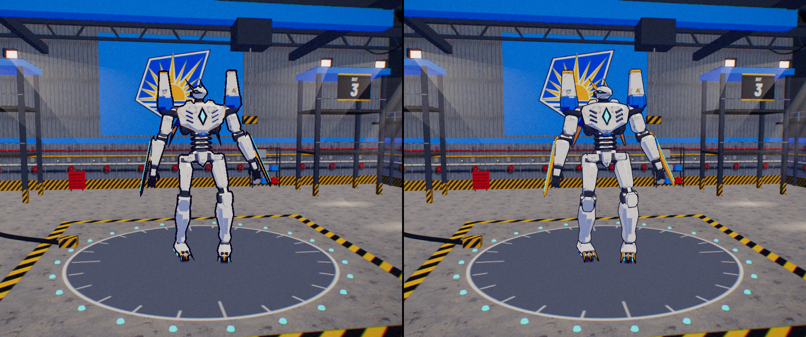
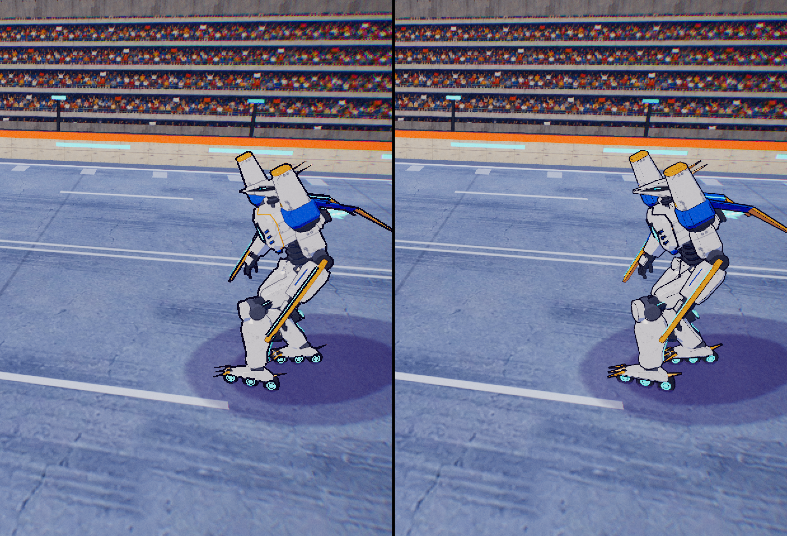
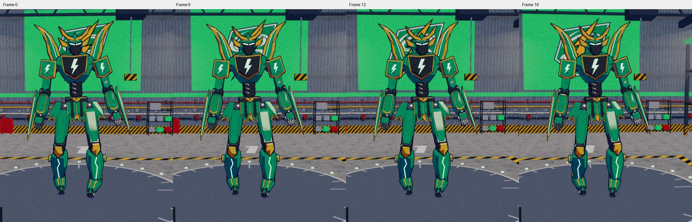
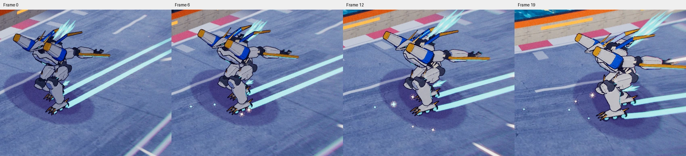

# Mech geometry ink — Step 2 review

Branch: `mech-lines`, based on `clean-ink` / `4ca6e54`.
Reviewed on 2026-10-16. Main and the owner's model-sheet edits are untouched.

## Result

Geometry ink is now the default for all 15 updated mechs. The thinner outer
shell preserves horns, gold blades, fingers and knee plates that tracing
previously swallowed. Inner strokes are tied to authored creases and plate
rims, so light changes no longer decide where a panel line exists.
`?mechLines=traced` keeps the Step 1 result available; current/procedural
comparison designs fall back to it automatically. Plain and low quality
retain their original hull rendering. The G-key toggle was verified in the
production build with `?dev=1`, where that existing developer shortcut is enabled.

The Blender scripts now generate pre-bevel lines, baked outline normals and
per-vertex shell widths, with exceptions in `ink-overrides.json`. All 45
updated GLBs and 15 production blends were rebuilt through Blender 5.2.2.
All exported triangle positions and shading normals match the baseline
exactly; no face repair was needed in this pass. Current Sunhawk's export
and comparison blend remain unchanged.

The runtime batches rigid joints into one hull draw and one `LineSegments2`
draw per visible mech LOD. LOD2 drops inner lines. This uses the same joint
matrices and existing LOD groups as armour. Both shaders retain alpha marks,
fog, theme ink, and the traveller mask. The pass chain and all background
ink/film calculations remain unchanged.

## Before / after

Baseline tracing is on the **left**, geometry ink on the **right**. Crops are
nearest-neighbour enlargements from the deterministic production-build tool.






All 15 mechs were inspected front/rear, including thin fins, shields, feathers,
weapons, decals and numbers. No new hull blotches, protruding shells, doubled
bevel rims or detached strokes were observed. Rear jets retain their circular
end-on appearance and painted side-view flames.

## Stability and compatibility

Twenty consecutive 60 Hz simulation frames were captured during a Kamaitachi
hangar orbit, and another twenty during Sunhawk's boost pose with a moving
key light. The authored strokes stayed attached; no plate-rim z-fighting or
lighting-driven line disappearances were observed in these samples. Normal
occlusion, subpixel coverage and the game's held animation drawings remain.





Animated crops: [orbit](../art/blender/ink-review/orbit.webp),
[boost](../art/blender/ink-review/boost.webp).

- Six-mech races on Meridian, Canyon and Helios rendered without shader or
  page errors. Ink colour followed each circuit's palette. Pack overlaps,
  skate/road contact, held weapons and translucent effects were inspected.
- Garage/hangar, paused race and results/victory views work. This build uses
  the race's orbit/victory scene behind results, rather than a separate
  podium renderer. Rig tests also exercise the victory and guard poses.
- Impact (`uImpact=2`), knockout-style painted still (`uStill=1`), CRT on/off,
  the existing low-quality fallback and current-model fallback were checked.
- LOD0/1/2 switched with the existing groups. Resize, a 4:3 classic frame,
  and resolution scale 0.65 updated both line/hull pixel sizes correctly.
- Alpha marks for all six pilots and the rigid traveller-mask transforms
  are covered by tests. Glows/decals/UV overlays/flames are excluded from
  authored line generation; shields and bubbles are created afterward.

The six anime comparisons (hangar and race, desktop/Nova/phone) have **zero
changed background pixels** outside the union of the mech masks dilated by
20 screenshot pixels. All six plain-look frames are **pixel-identical**.
Random idle and flame phases must be aligned as well as the frame clocks:
added meshes consume different UUID randomness during rig construction.
The comparison tool now accounts for that; it does not change gameplay.

## Performance

Production builds, headless Chrome/ANGLE Metal on Apple M1 Pro, high quality,
resolution scale 1, uncapped. Six-mech Helios race, Tempest versus Aurora,
seed 9, skip 95 seconds, followed by 90 warm-up and 900 measured frames.
Each measured frame advances 1/60 second and waits for GPU completion.
These are **frame work times**, not display FPS; Nova means its viewport and
DPR emulated on this Mac, not measurements from a physical Nova.

| Viewport | Mode | Calls/frame | Triangles/frame, all passes | Mean ms | P95 ms |
| --- | --- | ---: | ---: | ---: | ---: |
| 1280×720, DPR1 | clean-ink | 613.8 | 266,878 | 4.59 | 5.60 |
| 1280×720, DPR1 | geometry | 624.5 | 399,497 | 4.71 | 6.20 |
| 1280×720, DPR1 | new build, traced | 614.1 | 266,971 | 4.58 | 5.80 |
| 640×480, DPR2 | clean-ink | 601.2 | 262,335 | 5.94 | 6.50 |
| 640×480, DPR2 | geometry | 611.4 | 389,459 | 5.95 | 7.40 |
| 640×480, DPR2 | new build, traced | 601.5 | 262,428 | 5.95 | 6.80 |

Calls rise **1.7%**, below the 25% threshold. Submitted triangles rise
**48–50%** because shells reuse the surfaces and thick lines draw quads,
including the traveller pass when active. Mean time rises 0.13 ms desktop
and 0.01 ms at the Nova viewport in this sample; P95 increases 0.6/0.9 ms.
Small differences are subject to background load, shader caching and normal
FX randomness. These measurements do not establish a physical-handheld
frame-rate guarantee or cover every worst-case pack/particle scene.

## Asset cost

The 45 updated GLBs total **23,874,200 → 38,542,608 bytes** (+61.4%,
+14,668,408 bytes). Existing production Brotli files total
**6,645,006 → 10,373,986 bytes** (+3,728,980 transfer bytes); gzip totals
9,378,193 → 15,356,793 bytes. The game currently preloads these assets.
Triangles in the source armour are unchanged; growth is normal/width and
line data. Each row includes all three LODs.

| Model | Before bytes | After bytes | Change |
| --- | ---: | ---: | ---: |
| Sunhawk | 3,751,932 | 6,190,264 | +65.0% |
| Anubis | 1,052,852 | 1,697,260 | +61.2% |
| Daystar | 1,041,980 | 1,663,876 | +59.7% |
| Fujin | 1,788,584 | 2,881,004 | +61.1% |
| Horus | 1,261,932 | 2,046,256 | +62.2% |
| Kamaitachi | 1,779,084 | 2,874,760 | +61.6% |
| Longbow | 1,901,532 | 2,997,600 | +57.6% |
| Maul | 1,077,132 | 1,737,504 | +61.3% |
| Paladin | 2,033,116 | 3,250,772 | +59.9% |
| Raijin | 1,795,328 | 2,938,208 | +63.7% |
| Rampart | 1,084,084 | 1,748,432 | +61.3% |
| Razor | 950,220 | 1,517,644 | +59.7% |
| Seraph | 1,813,888 | 2,904,124 | +60.1% |
| Sobek | 1,461,168 | 2,372,552 | +62.4% |
| Stinger | 1,081,368 | 1,722,352 | +59.3% |

## Reproduce and follow up

Build `4ca6e54` and `mech-lines` in separate checkouts with `npm ci` and
`npm run build`. Serve baseline on 8091 and the new build on 8090 using
`HOST=127.0.0.1 PORT=<port> npm start`. Then, with Playwright and Pillow
available:

```sh
URL_A=http://127.0.0.1:8091/ URL_B=http://127.0.0.1:8090/ SIZES=desk,nova,phone node tools/ink-compare.mjs /tmp/ink-compare
LOOK=plain SIZES=desk,nova,phone node tools/ink-compare.mjs /tmp/ink-plain
node tools/ink-perf.mjs /tmp/ink-perf.json
```

`PW_CHANNEL=chrome PW_SOFTWARE=0` uses installed Chrome and its hardware
backend for comparisons. `PYTHON=/path/to/python` selects a Pillow-enabled
Python; `NODE_PATH` may select an installed Playwright module. The benchmark
uses hardware Chrome when `PW_CHANNEL=chrome` is set. Comparison images are
captured at desktop 1280×720/DPR1, Nova 640×480/DPR2, and phone 844×390/DPR3;
the game's high-quality drawing-buffer DPR cap remains 2 on the phone.

Validation: **1033 tests across 33 files passed**, `npx tsc --noEmit -p .`
passed, and `npm run build` passed. New tests exercise the real GLB ink
contracts, rigid pose alignment, LOD batching, opaque alpha marks, traveller
mask override, malformed-data rejection and the installed r186 line shader.
Existing export checks were retained. Raw results are beside these images:
[performance](../art/blender/ink-review/performance.json),
[asset sizes](../art/blender/ink-review/asset-sizes.json),
[background diff](../art/blender/ink-review/background-diff.json),
[plain diff](../art/blender/ink-review/plain-diff.json),
[render checks](../art/blender/ink-review/regression-checks.json).

Follow-up: review on the physical Nova and a phone, especially dense packs
and distant LOD transitions. Quantized/packed normals and widths, compressed
line data, or selective model loading could reduce the additional download
and memory cost. Per-part width/edge overrides remain available for artistic
tuning. No merge into main or hosted-server update is included in this pass.
